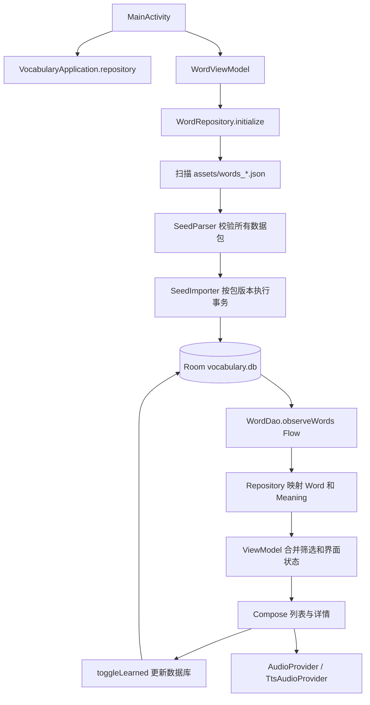

# 每日英语：程序结构、词库扩展与保留学习记录的更新方式

> 1.6 更新：实际安装包名已改为 `com.oxford.everyday`。下文旧包名覆盖安装说明仅适用于旧包名迁移版；跨包名必须先导出再导入学习记录。加载索引、批量导入及完整迁移步骤见[加载优化与包名迁移](加载优化与包名迁移.md)。下文保留早期架构说明。

当前 App 为 **1.4**，Room 数据库结构版本仍为 **2**。项目目录为 `E:\english`。下文的迁移表记录 1.0→1.1 加入 A2 时的变化；后续新增离线造句、聊天、Skill、参数设置和 AI 语音，词库、学习记录与数据库结构均不变。新增代码详见 [离线模型与造句](离线模型与造句.md)、[AI 聊天与自定义 Skill](AI聊天与自定义Skill.md)、[模型参数与 AI 语音](模型参数与AI语音.md)。

## 1. 这次更新如何保留你已标记的数据

这次是原应用的升级，不是另装一个应用或重新建立词库。

| 项目 | 升级前 | 升级后 |
| --- | --- | --- |
| Android applicationId | `com.oxford.a1` | 不变 |
| 本地数据库文件名 | `vocabulary.db` | 不变 |
| APK versionCode / versionName | `1` / `1.0` | `2` / `1.1` |
| Room 表结构版本 | `1` | `2`，执行明确的增量 Migration |
| A1 数据包 | `oxford-a1`，version 1 | 原文件、包 ID、版本不变 |
| A2 数据包 | 无 | 新增 `oxford-a2`，version 1 |
| 已有单词 ID 与 learned | 用户已经保存的值 | 全部保留 |

**请直接安装新版 APK，让 Android 将它作为更新安装。不要先卸载旧 App，也不要清除应用数据。**

本次生成的 APK 使用本机原有 debug 签名。若旧版来自这个项目在本机的构建，可直接升级。若 Android 报签名不一致，应找回旧版使用的签名密钥并重新签名构建，不能通过卸载来解决，否则会丢失本地学习记录。

安装后第一次启动：

1. Room 打开原来的 `vocabulary.db`。
2. Migration 1→2 只给 `meanings` 表增加 `phonetic`、`headword` 两列，并从旧 `words` 表回填原有音标和词形。
3. `words` 表不删除、不重建，`id` 与 `learned` 不变。
4. A1 数据包版本已经导入过，因此跳过 A1 导入。
5. 在事务中导入 A2。75 个与 A1 共用的词形沿用旧 ID 和旧掌握状态，其余 792 个新词默认未掌握。
6. 记录 `oxford-a2` 的版本；以后再次启动不重复导入。

目前“掌握”是**整个词形的状态**。例如你在 A1 标记了 `book` 已掌握，加入 A2 动词“预订”后仍然是已掌握，不会因为新增词性自动取消标记。A1 与 A2 页面中的同一词形共享标记。将来若要分别记录每个词性或义项的掌握程度，应新增学习记录表并设计迁移规则。

## 2. 当前词库规模与来源

| 范围 | 不同词条 | 单词＋词性组合 | 核对日期 |
| --- | ---: | ---: | --- |
| A1 | 898 | 1,076 | 2026-09-19 |
| A2 | 867 | 990 | 2026-09-22 |
| 合并 | **1,690** | **2,066** | A1/A2 有 75 个共用词形 |

范围依据 [Oxford 官方 Oxford 3000 / 5000 词表](https://www.oxfordlearnersdictionaries.com/wordlists/oxford3000-5000)，只提取 `data-ox3000` 对应等级的词形和词性。不会由模型猜测某个词属于哪个等级，也不会批量访问词典详情页、抓取释义或下载 Oxford 音频。

中文和 IPA 是项目自编学习内容，未经专业词典编辑审校。等级核对到“单词＋词性”，并非每一个自编中文义项的官方分级。发音使用 Android TTS；系统不接收这里的 IPA，所以同形异音词的 TTS 读音不保证与所选词性一致，应对照详情里的音标。

## 3. 从启动到显示的调用流程



`VocabularyApplication` 懒加载一个数据库和一个仓库实例。`MainActivity` 创建带 `SavedStateHandle` 的 ViewModel，并在 Compose 中通过 `collectAsStateWithLifecycle()` 订阅界面状态。数据库导入和 JSON 读取在 IO 线程执行，列表筛选在 Default 调度器执行，不在主线程导入词库。

## 4. 目录与文件职责

所有 Kotlin 文件位于 `app/src/main/java/com/oxford/a1/`。

| 文件或目录 | 主要职责 | 什么时候需要改 |
| --- | --- | --- |
| `VocabularyApplication.kt` | 持有数据库和 Repository | 增加应用级依赖时 |
| `MainActivity.kt` | Compose 入口、详情返回、说明窗口、语音设置与生命周期 | 页面接线或应用级交互改变时 |
| `data/local/Entities.kt` | Room 三张表及关联查询结果 | 增加持久化字段或表时，须配套 Migration |
| `data/local/WordDatabase.kt` | 数据库文件名、结构版本、Migration | 数据库结构变更时 |
| `data/local/WordDao.kt` | Flow 查询、标记切换、按 key 查找、词库写入 | 新增数据库查询时 |
| `data/local/SeedParser.kt` | 将 JSON 校验并转换为 SeedPack | 新增 JSON 字段或词性时 |
| `data/local/SeedImporter.kt` | 版本判断、事务导入、复用 ID、保留 learned | 导入策略改变时 |
| `data/repository/WordRepository.kt` | 发现数据包、调用导入、Entity 转界面模型 | 新数据来源或加载方式时 |
| `data/model/Word.kt` | Word、Meaning、筛选参数、词性中文名称 | 新筛选条件或模型展示字段时 |
| `viewmodel/WordViewModel.kt` | 组合 Flow、保存筛选和所选词条、接收 UI 操作 | 页面状态或学习操作增加时 |
| `ui/wordlist/WordListScreen.kt` | 列表、搜索、等级／词性／掌握筛选 | 调整浏览体验时 |
| `ui/worddetail/WordDetailScreen.kt` | 分词性展示释义与 IPA、播放、标记按钮 | 增加详情信息时 |
| `audio/AudioProvider.kt` | 发音接口与 AudioState | 替换发音实现时保持接口稳定 |
| `audio/TtsAudioProvider.kt` | 离线英语语音、焦点、重复播放、释放资源 | 接入音频资源或修改 TTS 行为时 |
| `ui/theme/` | Material 3 配色与字体 | 外观调整时 |

数据与工具：

```text
data/
  packs.json                  数据包目录：ID、版本、范围日期、预期数量
  oxford_a1_scope.json         A1 官方范围快照
  oxford_a2_scope.json         A2 官方范围快照
  editorial_a1.txt             A1 自编中文与音标
  editorial_a2.txt             A2 自编中文与音标
tools/
  extract_oxford_scope.py      从本地保存的官方词表 HTML 提取范围，无联网逻辑
  build_word_assets.py         校验编写源并生成 APK 要使用的 JSON
app/src/main/assets/
  words_a1.json
  words_a2.json
app/schemas/com.oxford.a1.data.local.WordDatabase/
  1.json                      保留旧结构，升级回归测试会用到
  2.json                      新结构，由 Room/KSP 导出
```

## 5. 三张表如何关联

### words：稳定的词形身份与学习记录

| 字段 | 含义 |
| --- | --- |
| `id: Long` | 数据库自动生成的主键，不能按新词表顺序重排 |
| `key: String` | 英文词形以 `Locale.ROOT` 转小写后的稳定键，唯一索引 |
| `word: String` | 原始展示词形，例如 `May` |
| `phonetic: String` | 单词级默认 IPA；旧数据兼容与备用值 |
| `learned: Boolean` | 用户的掌握状态，数据包更新不能覆盖 |

### meanings：等级、词性、释义与对应读音

主键是 `(wordId, partOfSpeech, cefrLevel)`，外键 `wordId → words.id`。

| 字段 | 含义 |
| --- | --- |
| `wordId` | 关联词形 |
| `partOfSpeech` | 官方词性，如 `noun`、`modal verb`、`linking verb` |
| `cefrLevel` | 此词性所属等级 |
| `chineseMeaning` | 对应词性的简洁中文 |
| `packId` | 拥有此条内容的数据包 |
| `phonetic` | 此词性的读音，v2 新增 |
| `headword` | 此等级词性的展示词形，v2 新增 |

这两个新字段解决具体问题：`close` 在 A1 动词中读 `/kləʊz/`，A2 形容词读 `/kləʊs/`；`May` 月份和 `may` 情态动词大小写不同。它们共享词形 ID，但分别保存展示内容，不互相覆盖。

### imported_packs：只记录内容包版本

`packId` 是主键，`version` 是已经成功导入的内容版本。只有整个包事务成功，才更新版本号。失败则内容写入和版本更新一起回滚。

## 6. 筛选、详情和掌握状态

`WordFilter` 保存关键词、词性、掌握状态、排序方向和等级。等级与词性必须匹配**同一条释义**：筛选“A2＋名词”不会把只有“A1 名词＋A2 动词”的词错误算进去。

筛选还会裁剪展示的释义。选 A2 后，中文搜索只搜索该等级下的释义；词形和音标也按选中的释义展示。详情沿用当前等级与词性条件，标记后不会因为“未掌握”筛选而突然消失，因为详情不应用掌握状态过滤。

UI 不直接改内存中的 `learned`。按钮通过 ViewModel 调用仓库，再执行 DAO 的 `UPDATE words SET learned = NOT learned WHERE id = :id`，最终由 Room Flow 把结果推回界面。因此重开 App 后记录仍然存在。

`SavedStateHandle` 用于关键词、筛选、排序、所选词 ID；它不代替 Room 保存学习记录。

## 7. 增加 B1 / B2 词库的完整步骤

不需要修改 Kotlin 单词列表，也不需要重新建立数据库。以下以 B1 为例。

### 步骤一：准备可核对的范围

从官方词表保存 HTML 到本地，运行离线提取工具：

```powershell
python tools/extract_oxford_scope.py path/to/saved-wordlist.html data/oxford_b1_scope.json --level b1
```

工具只读取指定 HTML，提取 `data-ox3000="b1"`，不跟随详情链接，也不下载音频。不要把网页完整 HTML 或其中音频链接放入 assets。

### 步骤二：编写相应的中文和 IPA

新增 `data/editorial_b1.txt`。格式：

```text
# word|IPA|第一个词性的中文|第二个词性的中文
example-word|IPA|中文释义
```

上面的 `example-word` 只是格式占位符，必须替换成实际在 B1 范围文件中的词。每行中文数量、顺序必须与范围 JSON 的词性数组一致。

不同词性不同读音时，用 `~` 分隔对应 IPA。现有 A2 的真实示例：

```text
record|ˈrekɔːd~rɪˈkɔːd|记录；纪录；唱片|记录；录制
```

`~` 两边分别对应官方范围中 `noun`、`verb`；相同读音只写一份。`;` 可用于同一词性下的多个读音，例如强读与弱读。

### 步骤三：注册数据包

在 `data/packs.json` 增加 `b1`，填写：

- `datasetId`：稳定且唯一的 ID，例如 `oxford-b1`；以后更新内容时不换 ID。
- `version`：第一次为 1；以后修改内容递增。
- `scopeCheckedOn`：实际核对日期。
- `wordCount`、`meaningCount`：实际范围文件统计值，不能猜测。

现有 A2 条目就是可复制的结构，但要改成实际 B1 元数据。

### 步骤四：生成并校验

```powershell
python tools/build_word_assets.py --level b1
python tools/build_word_assets.py --check
```

工具生成 `app/src/main/assets/words_b1.json`。它会检查缺词、多词、重复词、空音标、空释义、词性数量和词性级音标数量。所有请求生成的数据包通过检查后才写文件。

代码启动时自动发现 `words_*.json`；等级下拉菜单根据已加载内容生成，所以 B1 不需要手写到 UI。新增词性标签时才需要同时维护 `SeedParser.partsOfSpeech` 和 `posLabel()`。官方范围来源如果变化，也应更新 `DATA_SOURCES.md` 和来源说明。

### 步骤五：测试和构建升级包

递增 `app/build.gradle` 的 `versionCode`，使用原 `applicationId` 与原签名密钥。

```powershell
$env:JAVA_HOME = 'D:\Program Files\Android\Android Studio\jbr'
.\gradlew.bat :app:testDebugUnitTest :app:lintDebug :app:assembleDebug
```

增加 B1 后，更新测试中“整库总数”的预期值和范围断言，并增加相应的学习记录保留测试；不能为了让测试通过而去掉旧记录比对。

## 8. 修改现有词库与新增词库有什么不同

**修正 A2 的释义：**修改 `editorial_a2.txt` → 将 `packs.json` 中 `oxford-a2.version` 从 1 改为 2 → 重新生成 → 构建更高 APK versionCode。程序会在事务中替换这个包所属的释义内容，保留 `words.id` 和 `words.learned`。

**新增 B1：**使用新 `datasetId=oxford-b1`、version 1。共用词形复用旧行，新词形才插入。导入新包不会用新包的默认音标替换既有单词行；新包的音标保存在它自己的释义上。

**仅修改 Kotlin UI：**增加 APK 版本即可，不需要修改内容版本或 Room 结构版本。

**新增数据库字段：**增加 Room version，并编写从旧版本到新版本的 Migration。先跑真实旧结构的迁移测试，不能调用 `fallbackToDestructiveMigration()` 来绕过错误。

删除某个包的条目时，该包的新版本会移除它对应的释义，但不删除 `words` 行与掌握状态。完全没有释义的词形暂时不在列表显示；以后重新加入仍可复用原 ID 和学习状态。

## 9. JSON 格式说明

运行时 JSON 格式仍为 `schemaVersion: 1`，新增词性级 IPA 是可选字段，因此兼容旧 A1 JSON。

```json
{
  "schemaVersion": 1,
  "datasetId": "oxford-a2",
  "version": 1,
  "cefrLevel": "A2",
  "words": [
    {
      "word": "record",
      "phonetic": "ˈrekɔːd",
      "meanings": [
        { "partOfSpeech": "noun", "chineseMeaning": "记录；纪录；唱片", "phonetic": "ˈrekɔːd" },
        { "partOfSpeech": "verb", "chineseMeaning": "记录；录制", "phonetic": "rɪˈkɔːd" }
      ]
    }
  ]
}
```

实际生成的文件另含 `provenance`：官方范围 URL、核对日期、范围文件 SHA-256、自编内容与 TTS 来源说明。运行时导入只读取其所需字段；来源元数据用于审计。

不要把 `learned` 放到发布词库里；发布内容没有权利替用户重置学习记录。

## 10. 本次更新的验证方式与设备安装

`UpgradePreservesProgressTest` 使用导出的 **v1 schema** 在 Robolectric 独立测试目录创建旧数据库，导入所有 A1 内容，设置交替的已掌握／未掌握状态和非连续 ID，然后打开 v2 数据库并导入 A2。测试逐条比较原 `WordEntity`、A1 释义、两级 IPA 与包版本，关闭后再打开、再初始化，确认数据持久化且不会重复导入。这不会触碰你手机里的数据库。

其他测试核对 A2 官方词形和词性集合、同形异音词、等级与词性组合筛选，以及 Compose 中的 A2 浏览操作。

APK 路径：`E:\english\app\build\outputs\apk\debug\app-debug.apk`。

有设备连接后可执行：

```powershell
& D:\Android\SDK\platform-tools\adb.exe install -r E:\english\app\build\outputs\apk\debug\app-debug.apk
```

`-r` 表示更新已有应用并保留应用数据。不要执行 `adb uninstall`、`pm clear`，不要在系统设置中清除数据。当前没有连接设备，因此本次交付的是更新 APK，手机里的 A2 导入会在安装新版后首次启动时发生。
